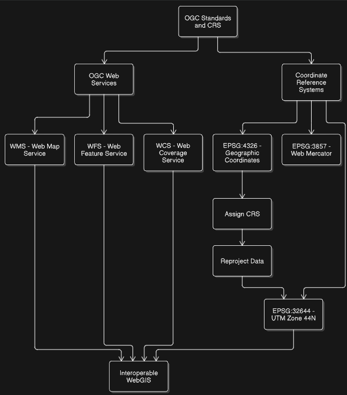

# S1 – OGC Services and Coordinate Reference Systems (CRS)

## 1. Objective

The objective of this study is to understand OGC web services and coordinate reference systems, and how they are used to publish and work with geographical data in a WebGIS application.

I explored these concepts using my Hyderabad Nearby Services WebGIS study area, which covers Ward 106 – Serilingampally and Ward 109 – Hafeezpet.

## 2. Understanding OGC Web Services

The Open Geospatial Consortium (OGC) develops standards that allow different GIS applications and systems to share geographical information.

These standards are important because data published through one GIS platform can be accessed by other compatible applications.

The three main OGC services covered in this assignment are WMS, WFS and WCS.

| Service | Full form | What it provides |
|---|---|---|
| WMS | Web Map Service | Rendered geographical map images |
| WFS | Web Feature Service | Geographic features and their attributes |
| WCS | Web Coverage Service | Raster coverage data and values |

### Application in my Hyderabad WebGIS project

My project uses PostgreSQL/PostGIS to store geographical data. GeoServer will be used to publish these layers through OGC services.

- WMS will be used to display map layers.
- WFS will allow users to retrieve healthcare facilities and their attributes.
- WCS will be used to access elevation data as a raster coverage.

## 3. Understanding Coordinate Reference Systems

A Coordinate Reference System (CRS) defines how geographical locations are represented using coordinates.

Choosing the correct CRS is important because it affects how locations, distances and areas are represented and measured.

### EPSG:4326 – Geographic CRS

- Name: WGS 84.
- Uses latitude and longitude coordinates.
- Units: Degrees.
- Commonly used for storing and exchanging geographic locations.
- Suitable for GPS coordinates and web data exchange.

### EPSG:3857 – Web Mercator

- Name: WGS 84 / Pseudo-Mercator.
- Uses projected X and Y coordinates.
- Units: Metres.
- Commonly used by online mapping platforms for displaying web map tiles.
- Introduces geographical distortion, particularly towards the poles, so it is not the preferred CRS for accurate area calculations.

### EPSG:32644 – WGS 84 / UTM Zone 44N

- Uses Easting and Northing coordinates.
- Units: Metres.
- Suitable for local distance and area measurements.
- Used in my Hyderabad study-area analysis.

Hyderabad lies within UTM Zone 44N, which covers longitudes from 78°E to 84°E.

### Comparison of the three CRS

| CRS | Coordinate type | Units | Main application |
|---|---|---|---|
| EPSG:4326 | Geographic | Degrees | Geographic location data |
| EPSG:3857 | Projected | Metres | Web mapping |
| EPSG:32644 | Projected | Metres | Local GIS measurements |

A projected CRS should be selected carefully for distance and area calculations. For my Hyderabad study area, EPSG:32644 is suitable for local measurements.

## 4. Assigning a CRS vs Reprojecting a Layer

These two operations are different in GIS.

**Assign CRS**

Assigning a CRS defines or corrects the coordinate reference information associated with a layer. It does not change the numerical coordinate values.

**Reproject Layer**

Reprojection transforms the coordinate values from one CRS to another while representing the same geographical location.

For my practical exercise, I reprojected the study-area polygon from EPSG:4326 to EPSG:32644.

## 5. Practical Exercise – CRS Transformation in QGIS

**Study area:** Ward 106 – Serilingampally and Ward 109 – Hafeezpet, Hyderabad.

**Software:** QGIS 4.2.3

### Steps performed

1. Opened my existing study-area QGIS project.
2. Checked that the original study-area layer used EPSG:4326.
3. Selected Export → Save Features As.
4. Selected GeoJSON as the output format.
5. Set EPSG:32644 as the target CRS.
6. Exported the layer as `study_area_utm44n.geojson`.
7. Loaded the exported layer and verified its CRS and coordinate values.
8. Used the QGIS Field Calculator to compare planar and ellipsoidal area measurements.

### Coordinate comparison

| Property | Original layer | Reprojected layer |
|---|---|---|
| CRS | EPSG:4326 | EPSG:32644 |
| Coordinate units | Degrees | Metres |
| X minimum | 78.3108 | 214,403.29 |
| Y minimum | 17.4385 | 1,929,995.85 |
| X maximum | 78.3639 | 220,039.64 |
| Y maximum | 17.4959 | 1,936,359.15 |

These values represent the layer's bounding-box extents, not the transformed coordinates of a single point.

## 6. Area Calculation

I compared two area calculations using the QGIS Field Calculator.

### Planar area

Expression:

```qgis
area($geometry) / 1000000
```

Result: **15.5148 km²**

### Ellipsoidal area

Expression:

```qgis
$area / 1000000
```

Result: **15.4966 km²**

The difference between the two measurements is approximately 0.0182 km², or 0.12%.

The planar calculation uses the projected geometry coordinates, whereas the ellipsoidal calculation considers the project's ellipsoid measurement settings.

For my study-area summary, I use **15.5148 km² as the planar area in EPSG:32644**, while clearly stating the measurement method.

## 7. WMS 1.1.1 vs WMS 1.3.0 – Understanding Axis Order

Web Map Service (WMS) allows a GIS client to request a rendered map image from a map server.

One important difference between WMS 1.1.1 and WMS 1.3.0 is how the bounding-box coordinates are interpreted for EPSG:4326.

| Feature | WMS 1.1.1 | WMS 1.3.0 |
|---|---|---|
| CRS parameter | SRS | CRS |
| EPSG:4326 coordinate order | Longitude, Latitude | Latitude, Longitude |
| Bounding-box axis order | X, Y | Follows the CRS axis definition |

For example, using the same study-area extent:

**WMS 1.1.1:**

```text
BBOX=78.3108,17.4385,78.3639,17.4959
```

**WMS 1.3.0:**

```text
BBOX=17.4385,78.3108,17.4959,78.3639
```

The order changes because WMS 1.3.0 follows the official axis order of EPSG:4326, which is latitude followed by longitude.

This difference is important because an incorrect BBOX order can result in a map being displayed in the wrong location or not being displayed correctly.

The actual axis-order behaviour will be tested later using GeoServer GetMap requests.

## 8. WFS 2.0 and Feature Filtering

Web Feature Service (WFS) provides access to geographical features along with their spatial geometry and attribute information.

WFS 2.0 supports several operations:

- **GetCapabilities:** Provides information about the available service operations and layers.
- **DescribeFeatureType:** Describes the attributes and structure of a feature type.
- **GetFeature:** Retrieves geographical features and their attributes.

### What are WFS filters?

Filters are used to retrieve only the geographical features that match particular conditions.

For example, in my healthcare dataset, I may want to retrieve:

- Only hospitals.
- Only named healthcare facilities.
- Facilities within a particular geographical boundary.
- Features that intersect a selected area.

WFS 2.0 uses Filter Encoding 2.0 (FES 2.0) to define these conditions.

A simple property filter looks like this:

```xml
<fes:Filter
    xmlns:fes="http://www.opengis.net/fes/2.0">
    <fes:PropertyIsEqualTo>
        <fes:ValueReference>category</fes:ValueReference>
        <fes:Literal>hospital</fes:Literal>
    </fes:PropertyIsEqualTo>
</fes:Filter>
```

This example selects features whose category attribute is equal to `hospital`.

Some commonly used filter operators are:

- PropertyIsEqualTo
- PropertyIsLike
- PropertyIsGreaterThan
- BBOX
- Intersects
- Within

In the assignment, WFS 2.0 filtering will be used to retrieve named healthcare facilities within the selected study area.

## 9. WCS – Web Coverage Service

Web Coverage Service (WCS) provides access to geographical coverage data, particularly raster datasets.

A coverage contains information represented through a grid of cells or pixels. Each cell can contain a value such as elevation, temperature or satellite measurement.

For example, a Digital Elevation Model (DEM) stores elevation values for geographical locations.

A WCS request allows users to access coverage data rather than only viewing a rendered image.

### Difference between WMS and WCS for raster data

- WMS displays a rendered representation of the DEM as a map image.
- WCS provides access to the underlying raster coverage data and its values.

This distinction is useful in remote sensing and terrain analysis, where the actual pixel values may be needed for further processing.

## 10. OGC API – Features

OGC API – Features is a modern OGC standard for accessing geographical features through web-based REST-style APIs.

It provides a resource-oriented approach, using HTTP requests to access collections and individual geographical features.

Common endpoint structures include:

```text
/collections
/collections/services
/collections/services/items
```

For example:

```text
/collections/services/items?limit=10
```

This request retrieves up to ten features from the services collection.

OGC API – Features commonly supports GeoJSON, making geographical data easier to access in modern web mapping applications.

### WFS vs OGC API – Features

| WFS 2.0 | OGC API – Features |
|---|---|
| Uses traditional OGC service operations | Uses REST-style resource endpoints |
| Commonly uses XML-based requests | Uses standard HTTP requests |
| Supports formats such as GML | Commonly supports GeoJSON |
| Uses Filter Encoding 2.0 | Provides web-friendly query parameters and filtering capabilities |

Both standards allow users to access geographical features, but OGC API – Features follows a more modern web API approach.

## 11. How OGC Services Work Together

The following diagram shows how the services can be used in my WebGIS project.

```text
             WEB GIS CLIENT
                   |
             Requests Data
                   |
       +-----------+-----------+
       |           |           |
      WMS         WFS         WCS
       |           |           |
  Map Images   Vector       Raster
               Features    Coverage
       |           |           |
       +-----------+-----------+
                   |
               GeoServer
                   |
              PostgreSQL
                / PostGIS
```

The client can request map images through WMS, retrieve healthcare features through WFS and access raster coverage data through WCS.

GeoServer acts as the map server and publishes the spatial layers stored in PostGIS or other supported data sources.

## 12. Practical Evidence and Project Files

The CRS transformation screenshot is stored at:

`evidence/day1/08_crs_reprojection.png`

The original and reprojected study-area datasets are stored under:

`analysis/study_area/`

The reprojected layer is:

`analysis/study_area/study_area_utm44n.geojson`

## 13. Learning Outcomes

After completing this exercise, I can:

1. Explain the purpose of OGC web services.
2. Differentiate WMS, WFS and WCS.
3. Explain the difference between WMS 1.1.1 and WMS 1.3.0 axis order.
4. Understand WFS 2.0 operations and feature filtering.
5. Explain the purpose of OGC API – Features.
6. Distinguish EPSG:4326, EPSG:3857 and EPSG:32644.
7. Explain why CRS selection affects distance and area calculations.
8. Differentiate assigning a CRS from reprojecting a layer.
9. Reproject a GeoJSON layer using QGIS.
10. Compare planar and ellipsoidal area measurements.

## 14. Pending Practical Work

- Test WMS 1.1.1 and WMS 1.3.0 using actual GeoServer GetMap requests.
- Complete WFS 2.0 GetFeature filtering using named healthcare facilities.
- Publish the DEM through GeoServer as a WMS and WCS coverage.
- Test the OGC services through the WebGIS client.

## Diagram: OGC Web Services Workflow

``mermaid
flowchart TD
 A[Geospatial Data] --> B[PostGIS Database]
 B --> C[GeoServer]
 C --> D[WMS Map Images]
 C --> E[WFS Geographic Features]
 D --> F[Web GIS Client]
 E --> F
``


## Visual Diagram


