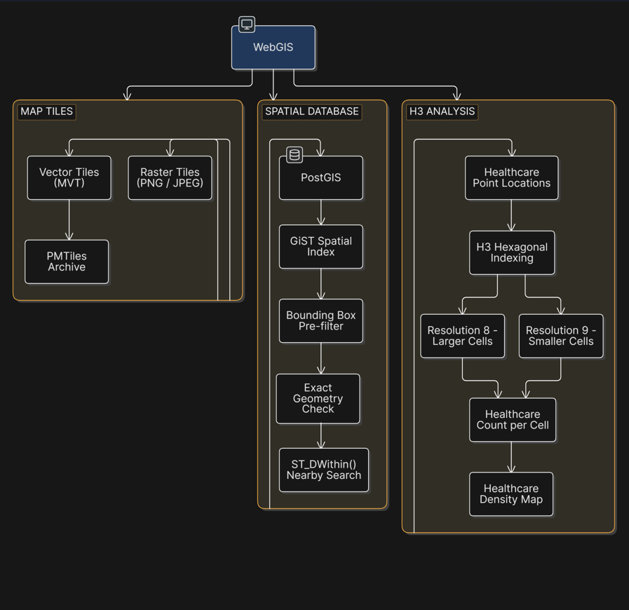

# S2 – Tiles, Spatial Indexes and H3

## 1. Objective

The objective of this study is to understand how map tiles are used in web mapping, how spatial indexes improve query performance in PostGIS, and how H3 hexagonal indexing can help analyse geographical data.

These concepts are relevant to my Hyderabad Nearby Services WebGIS project, where I work with healthcare locations, spatial queries and web-based maps.

## 2. Understanding Map Tiles

Map tiles are small sections of a digital map. Instead of loading an entire map at once, a web mapping application loads only the tiles required for the visible map area.

This makes map loading more efficient, especially when working with large geographical areas.

### XYZ Tile System

XYZ is a commonly used tile addressing system in web mapping.

Each tile is identified using three values:

- **X:** Horizontal tile position.
- **Y:** Vertical tile position.
- **Z:** Zoom level.

At zoom level 0, the world is represented by one tile. As the zoom level increases, the number of tiles increases by a factor of four at each level.

The total number of tiles at zoom level Z is:

Number of tiles = 4^Z

| Zoom level | Number of tiles |
|---|---:|
| 0 | 1 |
| 1 | 4 |
| 2 | 16 |
| 3 | 64 |
| 4 | 256 |

For a standard global XYZ Web Mercator tile matrix, the number of tiles at zoom level Z is 4^Z.

### Importance of Map Tiles

Map tiles are useful because they:

- Load only the visible part of a map.
- Reduce unnecessary data transfer.
- Improve map rendering performance.
- Support zooming and panning.
- Allow large maps to be displayed efficiently.

In my Hyderabad WebGIS project, map tiles can provide the basemap beneath the healthcare service locations.

## 3. Raster Tiles and Vector Tiles

There are two common approaches to delivering tiled geographical data.

### Raster Tiles

Raster tiles are pre-rendered map images, usually in PNG or JPEG format.

Each tile is an image showing geographical information at a particular zoom level.

Characteristics:

- Displayed as ready-made images.
- Styling is generally performed before the tiles are generated.
- Easy to display in web mapping applications.
- The individual image pixels do not contain editable feature attributes.

Example: A tiled WMS map displayed as PNG images.

### Vector Tiles

Vector tiles contain geographical data such as points, lines and polygons, along with selected attributes.

Unlike raster tiles, they do not simply contain rendered map images. The map client can style the geographical features.

Characteristics:

- Store simplified vector geometries and attributes.
- Support data-driven styling.
- Can display different styles without generating new image tiles.
- Are useful for interactive and detailed web maps.

### MVT – Mapbox Vector Tiles

MVT is a commonly used vector tile format.

It stores geographical features in a compact, tiled representation so that web mapping applications can load only the required geographical information.

In this assignment, MVT tiles will be served from PostGIS using pg_tileserv and displayed in MapLibre GL JS.

### PMTiles

PMTiles is a single-file archive format for storing tiled geographical data.

Instead of maintaining thousands of separate tile files, the tile data can be packaged into one archive.

For this assignment, vector tiles can be packaged into a PMTiles file and hosted on GitHub Pages.

The MapLibre client can request the required portions of the archive using HTTP Range Requests rather than downloading the entire file.

### Comparison

| Feature | Raster Tiles | Vector Tiles (MVT) | PMTiles |
|---|---|---|---|
| Data type | Images | Vector features | Tiled data archive |
| Common representation | PNG, JPEG | Encoded vector data | Single archive file |
| Styling | Mostly pre-rendered | Can be styled by client | Depends on archived tile format and client |
| Interaction | Limited feature-level interaction | Supports feature-level interaction | Depends on the archived tiles |
| Storage | Separate image tiles | Separate vector tiles | Multiple tiles packaged in one file |

## 4. Spatial Indexes in PostGIS

A spatial index helps a spatial database find geographical features more efficiently.

Without a suitable index, PostgreSQL may need to examine a large number of geometries to find the required records.

Spatial indexes reduce unnecessary geometry checks and improve the performance of spatial queries.

### GiST Index

GiST stands for Generalized Search Tree.

It is an indexing method supported by PostgreSQL and commonly used by PostGIS for spatial data.

Example:

```sql
CREATE INDEX services_geom_gix
ON public.services
USING GIST (geom);
```

This creates a GiST spatial index on the geometry column of the services table.

### How does a GiST spatial index work?

A spatial index commonly uses bounding boxes to identify possible matching geometries.

The process can be understood in two stages:

1. **Bounding-box pre-filter:** The index identifies geometries whose bounding boxes may satisfy the spatial condition.
2. **Exact geometry check:** PostGIS checks the actual geometries to remove false matches.

The bounding-box pre-filter reduces the number of records that require more expensive spatial calculations.

An index does not always guarantee faster execution. PostgreSQL may still choose a sequential scan when it considers that approach more efficient.

## 5. Query Plan Inspection Using EXPLAIN ANALYZE

EXPLAIN ANALYZE is used to understand how PostgreSQL executes a query and how long the query takes.

Example:

```sql
EXPLAIN ANALYZE
SELECT *
FROM public.services;
```

Some common query plan operations are:

| Query plan | Meaning |
|---|---|
| Sequential Scan | Examines table rows directly |
| Index Scan | Retrieves matching rows using an index |
| Bitmap Index Scan | Uses an index to identify candidate rows |
| Bitmap Heap Scan | Retrieves corresponding table rows using the bitmap results |

### ST_DWithin() vs ST_Distance()

Both functions are useful for spatial distance analysis, but they serve different purposes.

| Function | Purpose |
|---|---|
| ST_DWithin() | Checks whether two geometries are within a specified distance |
| ST_Distance() | Calculates the distance between two geometries |

ST_DWithin() is particularly useful for nearby-feature searches because PostGIS can use an appropriate spatial index to identify candidate geometries.

ST_Distance() calculates the actual distance. A filter based only on ST_Distance() is generally less suitable for index-based radius searching.

For nearby-service analysis, ST_DWithin() is useful for filtering features, while ST_Distance() can be used to calculate and report their distances.

## 6. Practical Exercise – Spatial Indexing in PostgreSQL/PostGIS

I tested spatial query performance using my existing PostgreSQL/PostGIS database.

**Database table:** public.services

**Number of records:** 7,363

**Geometry type:** POINT

**Original CRS:** EPSG:4326

### Existing Spatial Index

The services table already contained a GiST index on the geometry column.

I also inspected its other indexes, including the primary key and category-related indexes.

### Comparing Query Performance

I compared nearby-service searches using different approaches.

| Query approach | Query plan | Records returned | Execution time |
|---|---|---:|---:|
| Geography ST_DWithin() | Sequential Scan | 305 | 125.834 ms |
| Projected ST_DWithin() | Sequential Scan | 304 | 7.052 ms |
| Projected ST_DWithin() with functional GiST index | Bitmap Index Scan + Bitmap Heap Scan | 304 | 2.446 ms |

The execution times above are the actual observations from my individual query runs, not results from a controlled benchmarking experiment.

### Creating a Functional GiST Index

To improve the performance of queries using projected coordinates, I created a functional spatial index on the transformed geometry.

```sql
CREATE INDEX IF NOT EXISTS services_geom_utm44n_gix
ON public.services
USING GIST (ST_Transform(geom, 32644));

ANALYZE public.services;
```

This index supports spatial queries that use the same transformed geometry expression.

### What changed after creating the index?

Before using the functional index, the projected spatial query used a Sequential Scan.

After creating the index, the query plan included:

- Bitmap Index Scan.
- Bitmap Heap Scan.

The query returned 304 records, and the observed execution time decreased from 7.052 ms to 2.446 ms.

### Why were the geography and projected counts different?

The geography-based query returned 305 records, while the projected query returned 304 records.

I investigated the difference and identified one boundary case:

| Property | Result |
|---|---|
| Service ID | 6070 |
| Name | Place of Worship (unnamed) |
| Geography distance | 1,999.8215 m |
| Projected distance | 2,000.7759 m |

The record was within the 2,000 m threshold using the geography calculation but outside it using the projected planar calculation.

This difference occurs because geography and projected geometry use different distance calculation methods.

It also shows why the selected CRS and distance method should be stated when interpreting spatial query results.

## 7. H3 Hexagonal Spatial Indexing

H3 is an open-source hierarchical geospatial indexing system developed by Uber.

It divides the Earth's surface into a grid of mostly hexagonal cells.

Each cell has a unique H3 index, which can be used to represent and group geographical locations.

### H3 Resolutions

H3 provides 16 resolution levels, numbered from 0 to 15.

- Lower resolution: Larger hexagonal cells and broader geographical coverage.
- Higher resolution: Smaller cells and more geographical detail.

Two important resolutions for this assignment are:

| Resolution | Approximate average cell area |
|---|---:|
| 8 | 0.737 km² |
| 9 | 0.105 km² |

These values represent approximate global average cell areas, not the exact area of every cell.

### Applications of H3

H3 can be used for:

- Spatial aggregation of geographical features.
- Healthcare facility density mapping.
- Comparing service distribution across different geographical areas.
- Identifying areas with fewer mapped services.
- Creating hexagonal choropleth maps.
- Analysing geographical patterns at different spatial resolutions.

### Example for Hyderabad Healthcare Analysis

In my Hyderabad study area, healthcare facility point locations can be assigned H3 cell identifiers.

Facilities can then be grouped by their H3 index to calculate the number of hospitals, pharmacies and clinics in each hexagonal cell.

The same analysis can be performed at resolutions 8 and 9.

This helps compare healthcare service distribution at different spatial scales.

However, a low number of facilities in a hexagonal cell does not automatically mean that the area has poor healthcare accessibility.

Population distribution, road networks and actual walking distances should also be considered.

## 8. Practical Connection to the Hyderabad WebGIS Project

These concepts are useful for different parts of my assignment.

| Technology or concept | Application in my project |
|---|---|
| XYZ tiles | Displaying the web map basemap |
| Raster tiles | Displaying rendered map information |
| MVT | Delivering healthcare and hexagonal vector data |
| PMTiles | Packaging vector tiles into one archive for static hosting |
| GiST index | Improving spatial query performance in PostGIS |
| ST_DWithin() | Finding healthcare services within a specified distance |
| ST_Distance() | Calculating distances between locations |
| H3 resolution 8 | Aggregating services into relatively larger cells |
| H3 resolution 9 | Comparing service distribution using smaller cells |

The results from H3-based analysis will later be used to understand healthcare service distribution and compare it with population distribution and walking accessibility.

## 9. Key Learnings

After completing this study and practical exercise, I can:

1. Explain how map tiles improve web mapping performance.
2. Understand the XYZ tile system and zoom levels.
3. Differentiate raster tiles and vector tiles.
4. Explain the purpose of MVT and PMTiles.
5. Understand how GiST indexes improve spatial queries.
6. Explain the role of bounding-box pre-filtering.
7. Read common operations in an EXPLAIN ANALYZE query plan.
8. Differentiate ST_DWithin() and ST_Distance().
9. Create a functional GiST index using ST_Transform().
10. Explain H3 hexagonal indexing and its resolution levels.
11. Understand how H3 can be used to analyse healthcare service distribution.

## 10. Practical Evidence and Files

The PostGIS query performance results are based on my actual database experiment.

Relevant project components include:

- PostgreSQL/PostGIS database.
- public.services spatial table.
- Existing GiST geometry index.
- Functional GiST index using EPSG:32644.
- EXPLAIN ANALYZE query results.

The H3 aggregation and MVT/PMTiles generation will be performed during the relevant later assignment phases.

## 11. Pending Practical Work

- Generate H3 cells at resolutions 8 and 9 for the Hyderabad study area.
- Aggregate healthcare facilities by H3 cell.
- Compare raster and vector tile delivery.
- Publish MVT through pg_tileserv.
- Package vector tiles using PMTiles.
- Compare tile requests and performance in the MapLibre client.
## Diagram: Spatial Indexing and H3

``mermaid
flowchart TD
 A[Spatial Dataset] --> B[PostGIS]
 B --> C[GiST Spatial Index]
 B --> D[H3 Indexing]
 C --> E[Spatial Queries]
 D --> F[Hexagonal Cells]
 E --> G[Map Visualisation]
 F --> G
``


## Visual Diagram


