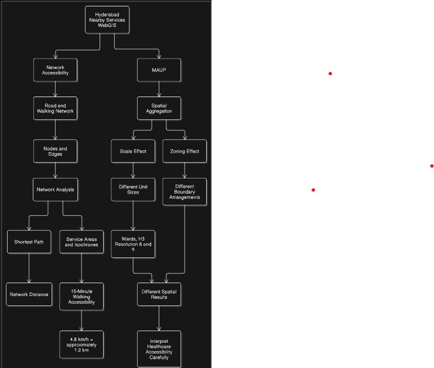

# S3 – Network Access and MAUP

## 1. Objective

The objective of this study is to understand network-based accessibility and the Modifiable Areal Unit Problem (MAUP), and how they influence geographical analysis.

These concepts are important in my Hyderabad Nearby Services WebGIS project, where I analyse access to healthcare facilities using road networks, walking distances and different geographical units.

## 2. Understanding Network-Based Accessibility

Network-based accessibility measures how easily a person can reach a destination by travelling along a connected transport network, such as roads and walking paths.

Unlike straight-line distance, network analysis considers the routes that are actually available for travel.

For example, a hospital may be located 500 metres away in a straight line, but the actual walking route may be 800 metres because of road layouts, buildings or other barriers.

### Straight-Line Distance vs Network Distance

| Straight-line distance | Network distance |
|---|---|
| Measures the direct distance between two points | Measures distance along connected roads and paths |
| Does not consider road layouts | Considers available routes |
| Usually shorter | Often longer |
| Also called Euclidean distance | Used in network analysis |

### Why is Network Analysis Important?

Network analysis is useful because it:

- Provides more realistic travel distances.
- Helps identify areas with limited access to essential services.
- Supports healthcare accessibility assessment.
- Helps compare access between different neighbourhoods.
- Can identify populations located far from healthcare facilities.

## 3. Understanding Road Networks

A road network can be represented as a graph consisting of nodes and edges.

### Nodes

Nodes represent locations where network segments connect or where routes begin and end.

Examples include:

- Road intersections.
- Junctions.
- Network endpoints.
- Origin and destination locations.

### Edges

Edges represent the connected segments between nodes.

Examples include:

- Roads.
- Streets.
- Walking paths.
- Pedestrian-accessible routes.

A network analysis algorithm uses these connected nodes and edges to find routes between locations.

### Network Connectivity

Network connectivity describes how different road and path segments are connected.

If two road segments are not properly connected in the network dataset, a routing algorithm may not be able to travel between them.

Therefore, the road network should be checked for:

- Missing connections.
- Incorrectly disconnected segments.
- Duplicate edges.
- Incorrect road direction restrictions.
- Routes that pedestrians cannot legally or physically use.

OpenStreetMap can provide road and pedestrian-path data for building a walking network.

## 4. Network Distance and Travel Time

Network analysis can measure both distance and travel time.

### Distance-Based Analysis

Distance-based analysis calculates the length of a route along the network.

For example, a walking route from a residential area to the nearest hospital may have a network distance of 1,000 metres.

### Time-Based Analysis

Travel time estimates how long it takes to reach a destination.

It depends on factors such as:

- Travel distance.
- Travel speed.
- Road and path conditions.
- Mode of transportation.

A basic travel-time calculation is:

Travel Time = Distance / Speed

For my assignment, the assumed walking speed is 4.8 km/h.

This means that a person can theoretically walk approximately 1.2 km in 15 minutes, assuming a constant speed.

### Walking Accessibility Assumptions

| Parameter | Value |
|---|---|
| Travel mode | Walking |
| Walking speed | 4.8 km/h |
| Time threshold | 15 minutes |
| Approximate distance threshold | 1.2 km |

These values are modelling assumptions. Actual walking times may differ because of road conditions, barriers, waiting time and individual walking speed.

## 5. Shortest Path and Service Areas

Two important applications of network analysis are shortest-path analysis and service-area analysis.

### Shortest-Path Analysis

Shortest-path analysis identifies a route between an origin and destination using a selected network cost.

The cost may be:

- Distance.
- Travel time.
- Other defined travel impedance.

For example, the shortest walking route from a residential location to a hospital can be calculated using the road network.

### Service Area and Isochrone Analysis

A service area identifies the locations that can be reached from a starting point within a specified distance or travel-time threshold.

An isochrone represents an area that can be reached within a particular travel time.

For example, a 15-minute walking isochrone around a hospital represents the network-accessible area that can theoretically be reached within 15 minutes.

Unlike a circular buffer, a network-based service area follows the available road and walking network.

### Straight-Line Buffer vs Network Service Area

| Straight-line buffer | Network service area |
|---|---|
| Uses a fixed radius around a location | Uses connected roads and paths |
| Creates a circular area for a point | Creates an area based on network accessibility |
| Does not consider road connectivity | Considers network connectivity |
| Easier to calculate | Requires a suitable network dataset |

A circular buffer may include locations that are close in straight-line distance but difficult to reach by walking. Network service areas provide a more realistic representation of potential accessibility.

## 6. Modifiable Areal Unit Problem (MAUP)

MAUP stands for Modifiable Areal Unit Problem.

It refers to the problem where statistical and spatial analysis results can change depending on how geographical areas are divided into zones or boundaries.

The original geographical dataset may remain unchanged, but the results can differ when the data is aggregated using different geographical units.

### Example

Suppose healthcare facilities are analysed using ward boundaries. The analysis is then repeated using smaller hexagonal cells.

The number of facilities in each area and the resulting spatial patterns may change, even though the original healthcare dataset remains the same.

MAUP has two main types.

### A. Scale Effect

The scale effect occurs when the results change because the size of geographical units changes.

For example:

- Large units: Administrative wards.
- Medium-sized units: Neighbourhoods.
- Smaller units: H3 hexagonal cells.

When healthcare facilities are grouped into larger areas, local differences may become less visible.

Smaller units can show more local variation, but may also contain fewer observations.

### B. Zoning Effect

The zoning effect occurs when results change because the arrangement of geographical boundaries changes, even when the zones have similar sizes.

For example, two different ways of dividing the same study area into zones may produce different healthcare facility counts and accessibility patterns.

This means that the placement of boundaries can influence the interpretation of spatial results.

## 7. MAUP in the Hyderabad WebGIS Project

My project studies healthcare service distribution in Ward 106 – Serilingampally and Ward 109 – Hafeezpet.

Healthcare facilities and population data can be analysed using different geographical units.

These include:

- Ward boundaries.
- H3 resolution 8 cells.
- H3 resolution 9 cells.

The results may differ because each geographical unit represents the study area at a different spatial scale.

For example, a ward may contain several healthcare facilities, but smaller H3 cells within that ward may have very different facility counts.

Comparing these results helps identify how the choice of geographical units influences the analysis.

### Why MAUP Matters in Healthcare Accessibility

MAUP is important because:

- Large administrative units may hide local accessibility differences.
- Smaller geographical units may show more detailed spatial variation.
- Changing boundaries can affect healthcare facility counts.
- Comparisons between different spatial units must be interpreted carefully.

A higher number of facilities in a geographical unit does not automatically mean better healthcare accessibility. Population, road connectivity and travel time must also be considered.

## 8. Practical Connection to the Hyderabad WebGIS Project

Network analysis and MAUP are relevant to different parts of my assignment.

| Concept | Application in my project |
|---|---|
| Road network | Provides walking routes between locations |
| Network nodes and edges | Represent road intersections and connected road segments |
| Shortest-path analysis | Finds routes between origins and healthcare facilities |
| Network distance | Measures distance along available walking routes |
| Walking speed | Uses the assumed speed of 4.8 km/h |
| 15-minute threshold | Represents approximately 1.2 km of walking |
| Service areas | Identifies areas reachable within a selected threshold |
| Ward-level aggregation | Summarises healthcare facilities by administrative ward |
| H3 resolution 8 and 9 | Compares healthcare distribution at different spatial scales |
| MAUP | Helps explain how different geographical units affect the results |

The project will compare straight-line distance and network-based accessibility to understand the difference between geographical proximity and practical walking access.

## 9. Key Learnings

After completing this study, I can:

1. Explain network-based accessibility.
2. Differentiate straight-line distance and network distance.
3. Understand nodes, edges and network connectivity.
4. Explain shortest-path analysis.
5. Understand service areas and isochrones.
6. Calculate approximate walking distance using travel speed and time.
7. Explain the difference between circular buffers and network service areas.
8. Define the Modifiable Areal Unit Problem.
9. Differentiate scale effect and zoning effect.
10. Explain how MAUP affects healthcare accessibility analysis.
11. Understand why population and road connectivity should be considered when interpreting healthcare service distribution.

## 10. Conceptual Diagram

The following diagram can be used to explain the main concepts covered in this study:

```text
             NETWORK ACCESSIBILITY
                      |
             Road and Walking Data
                      |
              Network Dataset
                      |
              Nodes and Edges
                      |
             Network Analysis
                /         \
               /           \
       Shortest Path     Service Area
               |           |
        Network Distance  Isochrones
               \           /
                \         /
             Healthcare Access


                  MAUP
                   |
          Spatial Aggregation
                   |
          +--------+--------+
          |                 |
      Scale Effect     Zoning Effect
          |                 |
     Different Unit    Different Boundary
         Sizes           Arrangements
          |                 |
          +--------+--------+
                   |
          Different Spatial
              Results
```

## 11. Pending Practical Work

- Prepare a suitable walking network using OpenStreetMap road and path data.
- Check the connectivity and suitability of the network for pedestrian routing.
- Generate shortest walking routes to healthcare facilities.
- Generate 15-minute walking service areas or isochrones.
- Compare network distances with straight-line distances.
- Compare healthcare distribution using ward boundaries and H3 resolutions 8 and 9.
- Examine how different spatial units affect the interpretation of healthcare accessibility results.

## Diagram: Network Accessibility Analysis

``mermaid
flowchart TD
 A[Healthcare Facilities] --> B[Pedestrian Network]
 C[Study Area and Buildings] --> D[Origin Points]
 B --> E[Network Distance Analysis]
 D --> E
 E --> F[15 Minute Service Areas]
 F --> G[H3 Aggregation]
 G --> H[Accessibility Comparison]
``


## Visual Diagram


