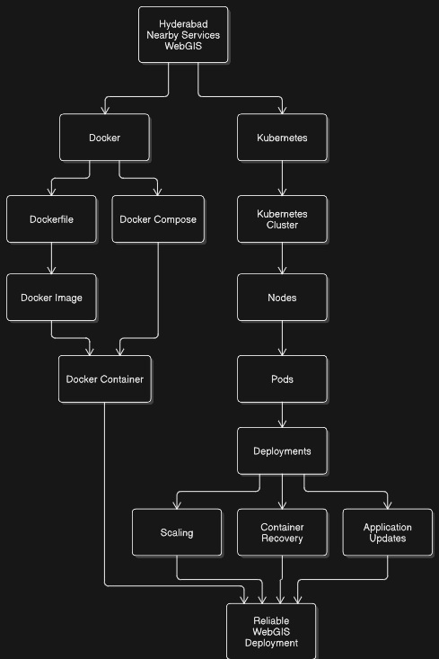

# S4 – Docker and Kubernetes

## 1. Objective

The objective of this study is to understand Docker and Kubernetes and how they help package, deploy, run and manage applications.

These technologies are useful for deploying WebGIS applications because they help maintain consistent environments and simplify application management.

## 2. What is Docker?

Docker is a platform used to package applications and their dependencies into containers.

A container provides an isolated environment in which an application can run consistently across different systems.

### Why is Docker Used?

- **Portability:** Applications can run across different environments.
- **Consistency:** Reduces environment-related problems.
- **Isolation:** Applications run in separate containers.
- **Deployment:** Makes application deployment easier.
- **Resource efficiency:** Containers share the host operating system kernel instead of requiring a separate operating system for every application.

### Example in the Hyderabad WebGIS Project

The Flask WebGIS backend requires Python, Flask, application code and other dependencies.

Docker can package these requirements so that the backend can run in a consistent environment.

This is a possible deployment approach for the project; the Docker exercises described later were performed using demonstration applications.

## 3. Docker Images and Containers

### Docker Image

A Docker image is a packaged template used to create containers.

It contains the application code, dependencies and instructions required to run an application.

### Docker Container

A Docker container is an instance of a Docker image running as an isolated process.

One Docker image can create multiple containers.

| Docker Image | Docker Container |
|---|---|
| Packaged template | Running instance |
| Used to create containers | Runs the application |
| Can create multiple containers | Created from an image |

### Basic Docker Commands

Build an image:

```bash
docker build -t hyderabad-webgis .
```

Run a container:

```bash
docker run -p 5000:5000 hyderabad-webgis
```

The port mapping makes the container's application port accessible through port 5000 on the host.

For a Flask application to be accessible outside its container, it must listen on `0.0.0.0` inside the container rather than only on `127.0.0.1`.

Other useful commands:

```bash
docker images
docker ps
docker ps -a
docker logs <container_name>
docker stop <container_name>
docker start <container_name>
docker rm <container_name>
```

## 4. Dockerfile

A Dockerfile is a text file containing instructions to build a Docker image.

It defines the base image, working directory, dependencies, application files and startup command.

Example:

```dockerfile
FROM python:3.12-slim

WORKDIR /app

COPY requirements.txt .

RUN pip install --no-cache-dir -r requirements.txt

COPY . .

EXPOSE 5000

CMD ["python", "app.py"]
```

This is an illustrative Flask Dockerfile. It would need to be adjusted to match the actual backend folder structure, dependencies and application startup configuration.

### Important Dockerfile Instructions

| Instruction | Purpose |
|---|---|
| FROM | Selects the base image |
| WORKDIR | Sets the working directory |
| COPY | Copies files into the image |
| RUN | Executes commands during image building |
| EXPOSE | Documents the application port |
| CMD | Defines the default startup command |

## 5. Docker Compose

Docker Compose is a tool used to define and manage multiple containers through a YAML configuration file.

It is useful when an application requires several services.

For example, a WebGIS application may contain:

- Flask backend.
- PostgreSQL/PostGIS database.
- Frontend web server.

Instead of starting each service separately, Docker Compose can manage them together.

### Example Commands

Start services:

```bash
docker compose up -d
```

Build and start services:

```bash
docker compose up -d --build
```

Check running services:

```bash
docker compose ps
```

Stop and remove the Compose containers:

```bash
docker compose down
```

Docker Compose makes local application development and testing easier.

## 6. What is Kubernetes?

Kubernetes is an open-source container orchestration platform.

It helps deploy, manage, scale and monitor containerized applications.

When an application runs across multiple containers, Kubernetes helps coordinate their deployment and operation.

### Main Functions

- Container deployment.
- Automatic scaling.
- Restarting failed containers when configured through suitable controllers.
- Managing multiple containers.
- Distributing workloads across machines.
- Managing application updates.

### Important Kubernetes Components

**Pod:** The smallest deployable unit in Kubernetes. A Pod contains one or more containers that share network and storage resources.

**Deployment:** Manages a set of Pods and helps maintain the desired number of running replicas.

**Node:** A machine that runs Pods.

**Cluster:** A group of nodes managed by Kubernetes.

**Replica:** A copy of an application Pod maintained by a controller such as a Deployment.

### Example

Suppose a WebGIS application is running inside a Pod managed by a Deployment.

If the Pod fails, Kubernetes can create a replacement to maintain the desired number of replicas.

This behaviour depends on the Deployment and its configuration.

## 7. Docker vs Kubernetes

| Docker | Kubernetes |
|---|---|
| Builds and runs containers | Orchestrates containerized workloads |
| Packages applications into images | Manages container deployments |
| Runs individual containers | Manages Pods and deployments across a cluster |
| Useful for packaging and execution | Useful for application orchestration and scaling |

Docker and Kubernetes perform different but complementary roles.

Docker is commonly used to build and run container images, while Kubernetes manages the deployment and operation of containerized applications.

## 8. Kubernetes Practical Commands

### Check Cluster Nodes

```bash
kubectl get nodes
```

Displays the nodes available in the Kubernetes cluster.

### Create a Pod

```bash
kubectl run nginx-demo --image=nginx --restart=Never
```

Creates a Pod using the Nginx image.

### Check Pods

```bash
kubectl get pods
kubectl get pods -o wide
```

Displays Pod status and additional information such as node placement and IP address.

### Inspect a Pod

```bash
kubectl describe pod nginx-demo
```

Displays detailed information about a Pod, including its configuration, status and events.

### View Container Logs

```bash
kubectl logs nginx-demo
```

Displays the logs generated by the container.

### Delete a Pod

```bash
kubectl delete pod nginx-demo
```

Deletes the specified Pod.

## 9. Kubernetes Deployments and Scaling

A Deployment manages the desired number of application replicas.

For example, a Deployment can be created using:

```bash
kubectl create deployment nginx-deployment --image=nginx
```

Check the Deployment:

```bash
kubectl get deployments
```

### Scaling

Scaling changes the number of running application replicas.

For example, increase the number of replicas to three:

```bash
kubectl scale deployment nginx-deployment --replicas=3
```

Check the running Pods:

```bash
kubectl get pods
```

Scale the Deployment back to one replica:

```bash
kubectl scale deployment nginx-deployment --replicas=1
```

### Updating an Image

A Deployment image can be updated using:

```bash
kubectl set image deployment/nginx-deployment nginx=nginx:1.31.8
```

Check the rollout:

```bash
kubectl rollout status deployment/nginx-deployment
```

Kubernetes supports controlled application updates through Deployment rollouts.

## 10. Practical Exercises Completed

The following exercises were performed as part of Docker and Kubernetes learning.

### Docker Exercises

1. Installed and configured Docker Desktop.
2. Checked Docker and Docker Compose versions.
3. Ran the `hello-world` container.
4. Started an Nginx container and accessed it through a browser.
5. Used a bind mount to display a custom HTML page through Nginx.
6. Created a Dockerfile and built a custom image.
7. Ran a container from the custom image.
8. Created and tested a Docker Compose configuration.
9. Practised starting, stopping and removing containers.

### Kubernetes Exercises

**Pod Introduction Lab**

1. Checked Kubernetes cluster nodes.
2. Viewed existing system Pods.
3. Created an Nginx Pod.
4. Checked its status and details.
5. Viewed its logs.
6. Deleted the Pod.

**Deployment Basics Lab**

1. Created an Nginx Deployment.
2. Scaled the Deployment from one to three replicas.
3. Scaled it back to one replica.
4. Updated the Nginx image.
5. Checked the rollout status.
6. Deleted the Deployment.

These exercises provided practical experience with container creation, image building, application deployment, scaling and basic workload management.

## 11. Practical Connection to the Hyderabad WebGIS Project

Docker and Kubernetes can support the deployment of the Hyderabad Nearby Services WebGIS.

| Technology | Possible Application |
|---|---|
| Docker | Package the Flask backend |
| Dockerfile | Define the backend image-building instructions |
| Docker Image | Store the packaged application |
| Docker Container | Run the WebGIS backend |
| Docker Compose | Manage Flask, PostgreSQL/PostGIS and frontend services |
| Kubernetes Pod | Run a containerized application |
| Kubernetes Deployment | Maintain the desired number of application replicas |
| Kubernetes Scaling | Adjust the number of application replicas based on demand |

Docker Compose can be used for local multi-service development, while Kubernetes can be used for managing application deployments in a cluster.

## 12. Key Learnings

1. Docker packages applications and dependencies into containers.
2. A Docker image is a template used to create containers.
3. A container is an instance of an image running in an isolated environment.
4. One image can create multiple containers.
5. A Dockerfile contains instructions for building an image.
6. Docker Compose manages multiple application services.
7. Kubernetes manages and orchestrates containerized workloads.
8. A Pod is the smallest deployable unit in Kubernetes.
9. Deployments help maintain the desired number of running Pods.
10. Kubernetes supports scaling and controlled application updates.

## 13. Conclusion

Docker simplifies application packaging and execution, while Kubernetes helps manage containerized applications through deployment, scaling and orchestration.

Both technologies are useful for developing and deploying reliable WebGIS applications.

The practical exercises helped me understand how containers are created and managed, how applications can be deployed, and how Kubernetes handles Pods and Deployments.

## 14. Evidence

Practical evidence is stored in the following locations:

- `evidence/docker/` – Docker practice screenshots.
- `study/06_killercoda_pod_intro.png` – Kubernetes Pod Introduction exercise.
- `study/07_killercoda_deployment_basics.png` – Kubernetes Deployment Basics exercise.


## Diagram: Container Deployment

``mermaid
flowchart TD
 A[WebGIS Client] --> B[Docker Image]
 B --> C[Kubernetes Deployment]
 C --> D[WebGIS Pod]
 E[PostGIS Database] --> F[StatefulSet]
 F --> G[PostGIS Pod]
 G --> H[Persistent Volume]
 D --> G
``


## Visual Diagram


